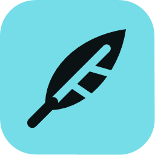

<p align="center">
  
</p>

<h1 align="center">FeatherLaunch</h1>

<p align="center">
  FeatherLaunch is a Minecraft: Java Edition launcher for older Windows and Linux PCs, written in
  Rust. It manages instances, mod loaders, and Modrinth mods and modpacks on about 50 MB of memory.
</p>

## Installation

- All downloads and instructions for FeatherLaunch can be found on our
  [website](https://featherlaunch.mahmoudalnakeeb.com/#download).
- There's no installer. On Windows, keep `featherlaunch.exe` in a folder of your own, not
  `Program Files`, so it can update itself. On Linux, extract the archive anywhere and run
  `featherlaunch/featherlaunch`.
- For a portable install, such as on a USB stick, put an empty `portable.txt` next to the program.
  Its data then stays in a `data` folder beside it.

### Development Builds

Please understand that these builds are not intended for most users. There may be bugs and other
instabilities.

Every push builds on [GitHub Actions](https://github.com/mahmoudalnkeeb/featherlaunch/actions), with
the result under each run's **Artifacts**.

## Community & Support

Feel free to [create a GitHub issue](https://github.com/mahmoudalnkeeb/featherlaunch/issues) if you
find a bug or want to suggest a new feature. Bug reports should include `launcher.log` from the
launcher's data folder.

Pull requests aren't accepted. See [CONTRIBUTING.md](CONTRIBUTING.md) for why, and for how to report
a security problem.

## Building

If you want to build FeatherLaunch yourself, you need Rust 1.88 or newer:

```bash
cargo build --release
```

On Windows you also need the MSVC build tools. On Linux, the program needs OpenGL (X11 or Wayland)
and, to stay signed in, a Secret Service keyring such as GNOME Keyring or KWallet.

The interface follows the design system in [DESIGN.md](DESIGN.md).

## Forking/Redistributing/Custom builds policy

You are free to fork, redistribute and provide custom builds as long as you follow the terms of the
[license](LICENSE) (this is a legal responsibility). If you made code changes rather than just
packaging a custom build, please do the following as a basic courtesy:

- Make it clear that your fork is not FeatherLaunch and is not endorsed by or affiliated with the
  FeatherLaunch project (<https://featherlaunch.mahmoudalnakeeb.com/>).
- Use your own Microsoft app ID instead of this project's. Register an Azure app, apply for
  [Mojang's review](https://aka.ms/AppRegInfo), then set the ID when you build:

  ```bash
  FEATHERLAUNCH_MSA_CLIENT_ID=your-client-id cargo build --release
  ```

If you have any questions or want any clarification on the above conditions, please open an issue
and ask.

Note that if you build this software with the provided app ID, you are accepting the
[Microsoft Identity Platform Terms of Use](https://learn.microsoft.com/en-us/legal/microsoft-identity-platform/terms-of-use).

## License [](LICENSE)

All launcher code is available under the GPL-3.0-only license.

The logo and related assets are under the [CC BY-SA 4.0](assets/LICENSE) license.

Components FeatherLaunch depends on keep their own licenses, listed in
[THIRD_PARTY_NOTICES.md](THIRD_PARTY_NOTICES.md).

Not an official Minecraft product. Not approved by or associated with Mojang or Microsoft. Minecraft
is a trademark of Mojang Synergies AB.
